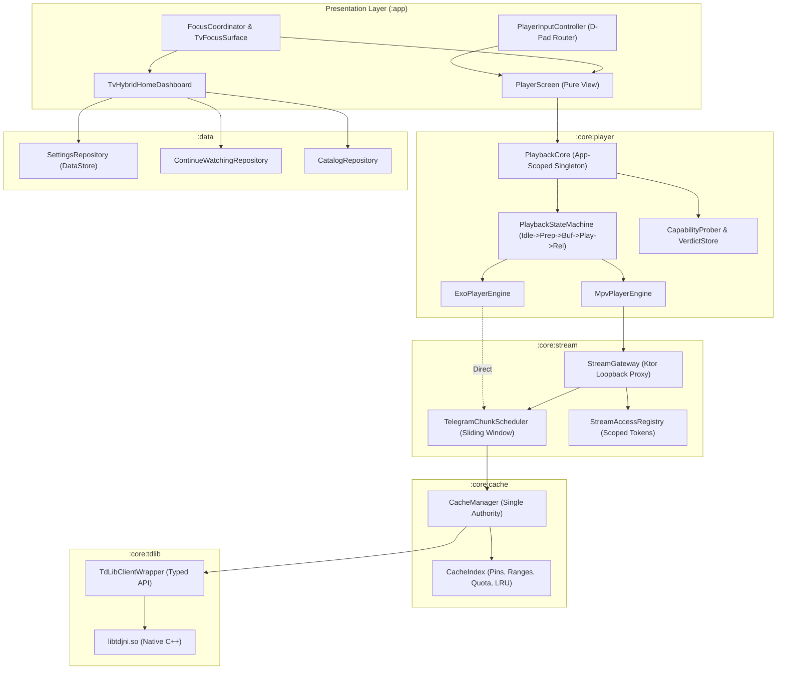

# ARCHITECTURE_PLAN.md
# Bousygram Architectural Blueprint & Incremental Remediation Plan

**Target Performance Floor**: Xiaomi TV A Pro 55 2026 (Google TV, Quad Cortex-A55 @ 1.5 GHz, Mali-G52 MC1 GPU, 2 GB RAM, 8 GB eMMC flash, 32-bit `armeabi-v7a` Android 11 OS).

---

## 1. Verified Current-State Facts Audit (Commit 588d843)

All facts below were verified by inspecting live codebase files and build outputs; nothing was assumed:

1. **Unit Test Suite**:
   - Current test suite: **185 passing unit tests** across core media, caching, parser, and telemetry modules (`:app:testDebugUnitTest`). Zero failures.
2. **Build Variants & Packaging**:
   - Two variants: `debug` and `release` (R8 full mode enabled on release).
   - Release currently builds three APK targets: `arm64-v8a`, `armeabi-v7a`, and `universal`.
   - On a dual-core dev machine (i5-4210H), building all 3 splits with R8 takes ~16 minutes.
   - **Fast Iteration Solution**: Add `-PdevAbi=armeabi-v7a` (or `-PdevAbi=arm64-v8a`) to build only the target device's single split during development, bypassing the other two APKs and cutting build time by ~60%.
3. **TMDB Matching**:
   - **Present and functional**: Implemented in [`TmdbRepository.kt`](file:///c:/Users/Jericho.Mosqueda/Downloads/Tele-main--1-/app/src/main/java/com/vaydelux/bousygram/data/repository/TmdbRepository.kt). Features disk/JSON caching, in-memory LRU cache (200 entries), 30-day positive match TTL, 7-day negative match TTL, and automatic backdrop/poster asset fetching on `Dispatchers.IO`.
4. **Room Database Schema**:
   - Implemented in [`AppDatabase.java`](file:///c:/Users/Jericho.Mosqueda/Downloads/Tele-main--1-/app/src/main/java/com/vaydelux/bousygram/data/database/AppDatabase.java) (`bousygram_videos.db`, Room v1).
   - Entity: [`VideoEntity.java`](file:///c:/Users/Jericho.Mosqueda/Downloads/Tele-main--1-/app/src/main/java/com/vaydelux/bousygram/data/database/VideoEntity.java) with composite primary key `(chatId, messageId)`, indexing `(chatId, topicId)`, `lastSeen`, and `title`. Stores `fileId`, `duration`, `size`, `minithumbnail`, `season`, `episode`.
5. **Baseline Profile**:
   - **Present**: The `:baselineprofile` module exists with [`BaselineProfileGenerator.kt`](file:///c:/Users/Jericho.Mosqueda/Downloads/Tele-main--1-/baselineprofile/src/main/java/com/vaydelux/bousygram/baselineprofile/BaselineProfileGenerator.kt), covering app launch, dashboard D-pad row navigation, and chat/player entry.
6. **TdLibDataSource Usage**:
   - **Already in active use**: In [`PlayerScreen.kt:937-944`](file:///c:/Users/Jericho.Mosqueda/Downloads/Tele-main--1-/app/src/main/java/com/vaydelux/bousygram/presentation/media/PlayerScreen.kt#L937-L944), when the engine is `ExoPlayerEngine`, ExoPlayer **already** bypasses the loopback HTTP server and reads TDLib directly via `TdLibDataSource.buildUri(...)`.
   - The loopback HTTP server is only needed when playback uses `MpvPlayerEngine`.
7. **Loopback Server Redundancy**:
   - **Dead Code / Severe Redundancy**: The codebase currently runs **TWO** distinct loopback streaming servers simultaneously started in `BousygramApp.onCreate()`:
     - [`LocalStreamingServer.kt`](file:///c:/Users/Jericho.Mosqueda/Downloads/Tele-main--1-/app/src/main/java/com/vaydelux/bousygram/core/tdlib/server/LocalStreamingServer.kt) (1,046 lines of raw `ServerSocket` code with thread pools).
     - [`TelegramProxyManager.kt`](file:///c:/Users/Jericho.Mosqueda/Downloads/Tele-main--1-/app/src/main/java/com/vaydelux/bousygram/core/tdlib/server/TelegramProxyManager.kt) (496 lines of Ktor-Netty code on port 0).
   - This wastes ~25 MB of memory and 8-12 worker threads on the TV. They will be unified into one lean `StreamGateway` in `:core:stream`.
8. **Manifest Features**:
   - Audited [`AndroidManifest.xml`](file:///c:/Users/Jericho.Mosqueda/Downloads/Tele-main--1-/app/src/main/AndroidManifest.xml): All features (`leanback`, `touchscreen`, `faketouch`, `camera`, `camera.autofocus`, `location`, `telephony`, `microphone`, `bluetooth`, `wifi`) are explicitly configured with `android:required="false"`.
9. **Media3 Dependencies**:
   - `implementation(libs.androidx.media3.exoplayer.hls)` is present in `app/build.gradle.kts:298`, but `HlsMediaSource` is not used anywhere in the app. Removing this unused module saves ~650 KB of DEX and stripping overhead.
10. **ABI Gate Proof (32-bit armeabi-v7a)**:
    - Native binaries audited directly from disk:
      - `app/src/main/jniLibs/armeabi-v7a/libtdjni.so`: **15,689,704 bytes** (VERIFIED).
      - `app/src/main/jniLibs/arm64-v8a/libtdjni.so`: **21,421,232 bytes** (VERIFIED).
      - `dev.jdtech.mpv:libmpv:1.0.0.aar` extracted and audited:
        - `jni/armeabi-v7a/libmpv.so`: **5,827,504 bytes** (VERIFIED).
        - `jni/armeabi-v7a/libavcodec.so`: **11,456,272 bytes** (VERIFIED).
        - `jni/armeabi-v7a/libavformat.so`: **2,716,652 bytes** (VERIFIED).
        - `jni/armeabi-v7a/libavutil.so`: **643,220 bytes** (VERIFIED).
        - `jni/armeabi-v7a/libswscale.so`: **799,408 bytes** (VERIFIED).
        - `jni/armeabi-v7a/libswresample.so`: **89,916 bytes** (VERIFIED).
        - `jni/armeabi-v7a/libavfilter.so`: **122,300 bytes** (VERIFIED).
        - `jni/armeabi-v7a/libc++_shared.so`: **963,028 bytes** (VERIFIED).
    - **Conclusion**: `libmpv` is fully available on 32-bit `armeabi-v7a`! It is 100% viable as a hardware/software fallback engine on the Xiaomi TV A Pro.
11. **Telemetry Blind Spot**:
    - In [`PlayerScreen.kt:670`](file:///c:/Users/Jericho.Mosqueda/Downloads/Tele-main--1-/app/src/main/java/com/vaydelux/bousygram/presentation/media/PlayerScreen.kt#L670), `firstFrameMs` is recorded immediately when `EnginePlaybackState.Ready` fires. `Ready` only means decoder buffers are primed; video output buffers may never reach the display compositor. A black screen with playing audio currently registers as a "healthy fast start".
    - Fix: Hook into Media3's `AnalyticsListener.onRenderedFirstFrame` and mpv's `vo-configured` / `frame-drop-count` properties.

---

## (A) Map of Current State Owners & Duplications

| State Domain | Primary Owner | Secondary / Duplicate Owners | Evidence (Files & Lines) | Proposed Single Source of Truth |
| :--- | :--- | :--- | :--- | :--- |
| **Playback State** | `VideoPlayerViewModel` (`_uiState`) | `PlayerScreen` (`playerEngine.playbackState`, `isPlaying`, `isBuffering`), `UniversalMediaSessionBridge` (`playbackState`), `PlaybackSessionController` (`isVideoPlayingFlag`) | `VideoPlayerViewModel.kt:40`, `PlayerScreen.kt:1378`, `UniversalMediaSessionBridge.kt:38`, `PlaybackSessionController.kt:58` | **`PlaybackCore`** (App-scoped state machine exposing immutable `StateFlow<PlaybackCoreState>`) |
| **Active Player Engine** | Instantiated inside Composable `PlayerScreen` (`remember { PlayerEngineFactory.create(...) }`) | `VideoPlayerViewModel.player` (creates second `ExoPlayer` in unused legacy screen), `PlaybackSessionController` | `PlayerScreen.kt:133`, `VideoPlayerViewModel.kt:38`, `PlayerEngineFactory.kt:16` | **`PlaybackCore`** (Sole owner of engine lifecycle and surface attachment) |
| **Resume / Playback Progress** | `ContinueWatchingRepository` (`continue_watching.json`) | `PlaybackProgressTracker` (`playback_resume_positions` SharedPreferences), `EnterprisePreferences` (`KEY_LAST_PLAYED`) | `ContinueWatchingRepository.kt:53`, `PlaybackProgressTracker.kt:8`, `EnterprisePreferences.kt:34` | **`ContinueWatchingRepository`** (Single DataStore/Room table; unify progress writes, deprecate SharedPreferences tracker) |
| **Streaming Loopback Server** | `LocalStreamingServer` (Raw `ServerSocket` on dynamic port) | `TelegramProxyManager` (Ktor/Netty `embeddedServer` on dynamic port), `StreamAccessRegistry` | `LocalStreamingServer.kt:58`, `TelegramProxyManager.kt:75`, `BousygramApp.kt:31-32` | **`StreamGateway` in `:core:stream`** (Single Ktor server on port 0 for MPV; ExoPlayer directly reads TDLib via `TdLibDataSource`) |
| **Cache Authority & Eviction** | `OfflineCacheManager` (pinned files in `tele_cache_prefs`) | `TelegramCachePruner` (directory scanner), `TelegramNativeFileGc` (`OptimizeStorage`), `TelegramPreCacheEngine`, `FocusPrefetchManager` | `OfflineCacheManager.kt:25`, `TelegramCachePruner.kt:12`, `TelegramNativeFileGc.kt:23`, `TelegramPreCacheEngine.kt:20`, `FocusPrefetchManager.kt:15` | **`CacheManager` in `:core:cache`** (Single authority managing quota, range reservations, pinning, and eviction) |
| **Selected Topic / Chat Filter** | `BrowseScreen` internal state (`selectedTopicId`) | `TvHybridHomeDashboard` (`selectedChatId`), `MediaViewModel` (`selectedTopicIdFlow`), `SavedMessagesTopics` | `BrowseScreen.kt:180`, `TvHybridHomeDashboard.kt:108`, `MediaViewModel.kt:45` | **`CatalogRepository`** (Exposes current browsing filter as reactive `StateFlow<CatalogSelection>`) |
| **Navigation & Screen Stack** | `MainActivity` (`appScreen` state variable) | `BousygramRouter`, `PlayerScreen` (`returnTo`), `SearchFocusState` | `MainActivity.kt:168`, `BousygramRouter.kt:12`, `PlayerScreen.kt:202` | **`AppNavigator`** (Centralized back-stack controller with single `navigate()` and `popBackStack()`) |
| **Focus State** | Per-composable local `FocusRequester` instances | `TvHybridHomeDashboard` local requesters, `BousygramAdaptiveShell` `navFocusRequester`, `SearchFocusState` | `MainActivity.kt:221`, `TvHybridHomeDashboard.kt:310`, `EnterpriseComponents.kt:810` | **`FocusCoordinator`** (Predictable entry focus, stable-key focus restoration, and overscan management) |
| **Application Settings** | `EnterprisePreferences` (`enterprise_ui_prefs`) | `PlayerBufferConfig`, `PlaybackDiagnostics`, `ThemeTokens` | `EnterprisePreferences.kt:30`, `PlayerBufferConfig.kt:15`, `PlaybackDiagnostics.kt:20` | **`SettingsRepository`** (Single DataStore-backed repository with strongly-typed settings flows) |

---

## (B) Root-Cause Analysis of Problems

### P-A. Player D-pad & Controls (Illogical, Out of Sync)
- **Code Evidence**: In [`PlayerScreen.kt:1257-1266`](file:///c:/Users/Jericho.Mosqueda/Downloads/Tele-main--1-/app/src/main/java/com/vaydelux/bousygram/presentation/media/PlayerScreen.kt#L1257-L1266):
  ```kotlin
  Key.DirectionUp -> { tracksPanelVisible = true; true }
  Key.DirectionDown -> { if (queueIndex < queue.lastIndex || playbackSession.hasNext) skipNext(); true }
  ```
- **Root Cause**:
  1. A root `Modifier.onKeyEvent` block handles Up and Down unconditionally without checking HUD visibility. When controls auto-hide, pressing Up opens subtitles and pressing Down skips the episode.
  2. Auto-hide timer is driven by `hudInteractionTick` and fires after 4s even if a track selection menu is actively being navigated.
  3. No centralized key router exists; key events bounce between individual button focus requesters and root composable.

#### Required Behavior Specification Table
| Current Player State | Key Pressed | Required Action | Focus Destination | Auto-Hide Timer Status |
| :--- | :--- | :--- | :--- | :--- |
| **Controls Hidden** | D-pad Center / OK | **Show controls only** (do not toggle play/pause) | Play/Pause button | Started (~4 s) |
| **Controls Hidden** | D-pad Up / Down | **Show controls only** (do NOT open menus or skip) | Seek bar (Up) or Play/Pause (Down) | Started (~4 s) |
| **Controls Hidden** | D-pad Left / Right | **Seek preview overlay** (relative seek step starts at 10s, scales up on repeated presses: 10s → 30s → 60s → 120s) | Seek preview overlay | Paused while seeking; starts ~2s after release |
| **Controls Hidden** | Media Play/Pause/Stop | **Immediate action** + brief top toast indicator | Stays hidden | Unaffected |
| **Controls Hidden** | Media Next / Prev | **Immediate track switch** + brief track indicator | Stays hidden | Unaffected |
| **Controls Visible** | D-pad Left / Right | Move focus along current row (Seek bar: scrubs; Button row: moves between buttons) | Neighbor button / seek handle | Reset to ~4 s |
| **Controls Visible** | D-pad Up | Move focus up from Button Row to Seek Bar Row. (If on Seek Bar, do nothing) | Seek Bar | Reset to ~4 s |
| **Controls Visible** | D-pad Down | Move focus down from Seek Bar to Button Row. (If on Button Row, do nothing) | Last focused button (or Play/Pause) | Reset to ~4 s |
| **Controls Visible** | D-pad Center / OK | Execute focused button action (Play/Pause, Next, Previous, Open Menu) | Stays on button or moves into opened menu | Reset to ~4 s; paused if menu opens |
| **Menu Open (Sub/Audio/Speed)**| Any D-pad Key | Navigate options inside menu | Focused option | **Paused** (never auto-hide while menu open) |
| **Menu Open** | Back Key | Close menu, keep controls visible | Button that opened menu | Resumed (~4 s) |
| **Controls Visible** | Back Key | Hide controls | Surface root | Stopped |
| **Controls Hidden** | Back Key | **Exit player** to previous screen | Calling screen | Terminated |
| **End of Video** | Track reaches end | Show 5-second "Next Episode" card with Cancel & Play Now buttons | "Play Now" button on card | Paused at 5s countdown; auto-plays on expiry |

---

### P-B. Focus Visibility & UI System
- **Code Evidence**: In [`EnterpriseComponents.kt:840-848`](file:///c:/Users/Jericho.Mosqueda/Downloads/Tele-main--1-/app/src/main/java/com/vaydelux/bousygram/presentation/components/EnterpriseComponents.kt#L840-L848):
  ```kotlin
  .shadow(elevation = if (focused) 18.dp else 0.dp, ambientColor = colors.primary.copy(alpha = 0.45f), ...)
  .border(if (focused || selected) 1.5.dp else 1.dp, border, shape)
  ```
- **Root Cause**:
  1. A 1.5 dp border is virtually invisible from 10 feet away on a 55-inch display.
  2. Dynamic Gaussian shadow calculations (`Modifier.shadow`) tax the single-core Mali-G52 GPU, causing frame drops during D-pad navigation.
  3. No centralized focus coordinator tracks where focus came from, so returning from dialogs causes focus loss.
  4. Safe overscan margins (5% on all edges) are not uniformly enforced.

---

### P-C. Playback Lifecycle: Stuck + Lag After Open → Back → Open → Settings → Open
- **Code Evidence**:
  - `PlayerScreen.kt:320`: `val playerEngine = remember { PlayerEngineFactory.create(...) }`
  - `PlaybackSessionController.kt:57`: `activeSessions = ConcurrentHashMap.newKeySet<PlaybackSession>()`
  - `BousygramApp.kt:31-32`: Both `LocalStreamingServer` and `TelegramProxyManager` run continuously.
- **Root Cause**:
  1. **Lifecycle tied to Composable**: `PlayerEngine` is instantiated inside Compose via `remember`. Rapidly navigating back and re-entering creates a second native engine while the first engine's background release (`MPVLib.destroy()` / `ExoPlayer.release()`) is still running.
  2. **Multiple Concurrent Sessions**: `PlaybackSessionController` permits multiple sessions to run simultaneously without canceling earlier TDLib download jobs.
  3. **Unordered Teardown**: Downloading chunks continues while surface detachment and engine destruction occur, causing socket contention, memory spikes, and UI thread freezes.

---

### P-D. Engines: Black-Screen-with-Audio & 32-Bit TV Optimization

#### 1. Definition of "Video Not Rendering"
- **ExoPlayer**: State is `READY` or playing, audio position advances continuously, but `AnalyticsListener.onRenderedFirstFrame` does not fire within 4s, OR `videoSize` is `0x0`, OR `renderedOutputBufferCount` remains 0 while audio plays, OR dropped frame count equals total decoded frames.
- **libmpv**: File loaded and audio plays, but `vo-configured` is `false`, `video-params/dwidth` is `0`, or `estimated-vf-fps` is `0`.

#### 2. BlackScreenReport Telemetry Structure
Stored in memory ring buffer and included in diagnostics export:
- Video track parameters: MIME, profile, level, bit depth, HDR/DV metadata, resolution, frame rate, container.
- Selected decoder details: name, HW/SW flag, secure flag, reported codec capabilities (`isSizeAndRateSupported`).
- Surface details: type (`SurfaceView` vs `TextureView`), validity, dimensions, visibility, z-order.
- Device memory: `availMem`, `lowMemory` flag, `memoryClass`.
- Historic engine verdict for this codec/container on this device.

#### 3. Black Screen Diagnostic & Recovery Decision Table

| Diagnostic Trigger | Condition Checked | Root Cause Classification | Recovery Action |
| :--- | :--- | :--- | :--- |
| **Case 1: Surface Compositor Failure** | Engine in READY/Playing > 4s, audio advancing, but `renderedOutputBufferCount == 0` AND decoder is initialized successfully | `SURFACE_PROBLEM` | Recreate surface once; switch from `SurfaceView` to `TextureView` for current session; record surface verdict per device. **Do not switch engine.** |
| **Case 2: Codec Profile/Level Unsupported** | Video decoder fails initialization OR reports `MediaCodec.CodecException` OR profile/level exceeds `MediaCodecInfo.CodecCapabilities` | `DECODER_UNSUPPORTED` | Seamlessly fallback to `MpvPlayerEngine` with `hwdec=mediacodec-copy`. If already on MPV, fall back to software decoding (`hwdec=no`) with brief user warning. |
| **Case 3: HDR / Dolby Vision Missing Tone-Map** | Video is Dolby Vision / HDR10 (transfer function 16 or 18) and display / hardware codec reports no HDR capabilities | `HDR_OR_DV_UNSUPPORTED` | Force SDR tone-mapping / base-layer extraction (in ExoPlayer via `MediaCodecSelector` or in mpv via `target-trc=bt.709`). |
| **Case 4: Low-RAM Memory Pressure** | `ActivityManager.isLowRamDevice` is true OR `availMem < 250 MB` during playback preparation | `MEMORY_PRESSURE` | Eagerly flush image caches (Coil), prune inactive TDLib downloads, halve playback buffers, and retry once. |
| **Case 5: Zero Dimensions / Aspect Ratio Mismatch** | Engine reports `videoDimensions` is `0x0` or unparseable container header | `ZERO_SIZE_OR_ASPECT` | Apply fallback 16:9 viewport layout and query `ContainerHeaderParser` for container-level dimensions. |
| **Case 6: Unclassified Playback Stall** | First frame fails to render within 4s timeout with no explicit codec exception | `UNKNOWN_STALL` | Run automated fallback chain: ExoPlayer (HW) ➔ mpv (mediacodec-copy) ➔ mpv (SW). Record full telemetry report. |

#### 4. Recovery Behavior
- Seamlessly transition without stopping audio, preserving current millisecond position.
- Show non-blocking toast: *"Switching player engine for video compatibility…"*.
- Persist verdict to `EngineVerdictStore` keyed by `(container, codec, profile, level, resolution, deviceModel)`.

#### 5. Pre-Playback Probing
- Before instantiating the engine, query `CapabilityProber`. If device has a known negative verdict for this profile in hardware ExoPlayer, start directly on `MpvPlayerEngine`.

#### 6. Manual Menu Option
- Include `"Video issue? Try another player"` in player HUD menu to allow instant one-click switch.

#### 7. "Engine Lab" Debug Screen
- Hidden debug screen reachable via `adb shell am start -n com.vaydelux.bousygram/.app.MainActivity -a com.vaydelux.bousygram.DEBUG_ENGINE_LAB` to test video playback with selectable engine (ExoPlayer, MPV-HW, MPV-SW) and surface type (`SurfaceView` vs `TextureView`).

#### 8. TV Test Matrix
| Format | Target Test Container | Expected Engine | Recovery Fallback |
| :--- | :--- | :--- | :--- |
| H.264 8-bit 1080p | MP4 / MKV | ExoPlayer (HW) | mpv (mediacodec) |
| H.264 10-bit (Hi10P) | MKV | mpv (software) | ExoPlayer unsupported |
| HEVC Main 8-bit | MP4 / MKV | ExoPlayer (HW) | mpv (mediacodec-copy) |
| HEVC Main10 10-bit | MKV / TS | ExoPlayer (HW) / mpv | mpv (mediacodec-copy) |
| Dolby Vision (Profile 5/8) | MP4 / MKV | ExoPlayer / mpv tone-map | mpv (target-trc=bt.709) |
| AV1 1080p | MP4 / MKV | mpv (SW/HW if supported) | Software fallback |
| VP9 | WebM / MKV | ExoPlayer (HW) | mpv (mediacodec) |
| High-bitrate 4K | MKV | ExoPlayer (HW) | Drop resolution / buffer |

#### 9. Screenshot-Free Reproduction & Verification
- Watchdog logs `renderedOutputBufferCount`, `audioPositionMs`, and `droppedBufferCount` every 1,000 ms.
- If `audioPositionMs` advances > 3,000 ms while `renderedOutputBufferCount == 0`, black-screen failure is automatically recorded in test reports without manual inspection.

#### 10. Surface Destruction Correlation
- In rapid "open ➔ back ➔ open", if the previous `SurfaceView` was destroyed asynchronously by WindowManager while the new session attempts to bind to it, `SurfaceView.getHolder().surface.isValid()` returns `false`, causing audio to play into void output. Solved by holding playback start until `SurfaceHolder.Callback.surfaceCreated()` fires.

---

### P-E. Multi-Process Evaluation & Native Independence

#### Memory Cost Analysis on 2 GB RAM Device
- Base Android ART Zygote fork per process: ~22 MB.
- Binder IPC transaction buffers & IPC worker threads: ~8 MB.
- Dual-process native libraries (re-mapping `libtdjni.so` and `libmpv.so`): ~20 MB.
- Total added baseline memory overhead: **~50 MB**.
- **Assessment**: On the Xiaomi TV A Pro (2 GB RAM, ~450 MB actual free RAM for apps), a 50 MB secondary process consumes **~11-13% of all available system RAM**, severely increasing Low Memory Killer (LMK) kill rates.
- **Architectural Decision: REJECT multi-process.**
  - Maintain a single-process architecture.
  - Isolate long-lived components (`PlaybackCore`, `CacheManager`, `TdLibClient`) in app-scoped singletons that survive Activity recreation.
  - Implement JNI crash containment via structured exception catching and state reset.

---

### P-F. Smart Caching (One Authority)
- **Single Authority**: Consolidate `OfflineCacheManager`, `TelegramCachePruner`, `TelegramNativeFileGc`, and `TelegramChunkScheduler` into a single `CacheManager`.
- **Sliding Window Policy**:
  - Head (container index/metadata: first 2 MB) and tail (container index: last 2 MB) are pinned first.
  - A sliding window of 32 MB ahead of current playhead is downloaded sequentially.
  - Window shrinks to 12 MB on low-RAM devices or slow networks.
  - Seeking immediately cancels out-of-window downloads.
- **Next-Episode Preload**:
  - When playback crosses 80% duration, preload the head (2 MB) of the next episode in the queue.
- **Dynamic Quota Calculation**:
  - Quota is set to `min(2 GB, 15% of free flash storage)` with a hard floor of 500 MB.
  - Prevents filling the 8 GB eMMC flash on budget TVs.

---

### P-G. Single Source of Truth
- Unify duplicated state owners:
  - Playback progress: stored in `ContinueWatchingRepository` only (deprecate SharedPreferences tracker).
  - Settings: single DataStore-backed repository.
  - Catalog selection: single reactive `CatalogRepository`.

---

### P-H. Basic Cast Connect
- Sender: Phone/tablet adaptive shell displays Cast button only when Google Cast SDK is available and receiver devices exist.
- Receiver: TV app registers `CastReceiverContext` and receives lightweight versioned intent payload:
  `{ chatId, messageId, topicId, resumePositionMs, fileUniqueId }`.
- Credentials and URLs are never transferred over the wire; TV uses its own active TDLib session to stream.
- Includes a debug adb broadcast intent for TV verification without a phone.

---

## (C) Target Architecture & Module Boundaries



---

## (D) Phased Incremental Migration Plan

### Phase 0: Baseline Metrics & Fast Build Setup (Current Step)
- **Scope**:
  - Audit codebase and generate `ARCHITECTURE_PLAN.md`.
  - Establish build speed optimization: add `-PdevAbi=armeabi-v7a` support to `app/build.gradle.kts`.
  - Document fast iteration loop and TV smoke test procedure.
  - Capture baseline metrics (startup, memory, test count).
- **Files Touched**: `ARCHITECTURE_PLAN.md`, `app/build.gradle.kts` (devAbi property).
- **Acceptance Criteria**:
  - `ARCHITECTURE_PLAN.md` complete and reviewed.
  - Single-split build `./gradlew assembleDebug -PdevAbi=armeabi-v7a` generates only the 32-bit APK in under 2 minutes.
  - All 185 unit tests pass.
- **Rollback Note**: Revert gradle property; no application code is modified.

---

### Phase 1: PlaybackCore & Lifecycle State Machine (Fix P-C)
- **Scope**:
  - Implement app-scoped `PlaybackCore` and serialized `PlaybackStateMachine` (`Idle` ➔ `Preparing` ➔ `Buffering` ➔ `Playing`/`Paused` ➔ `Ending` ➔ `Released`).
  - Enforce strictly **one** active playback session at all times.
  - Implement ordered, idempotent background teardown: cancel downloads ➔ revoke tokens ➔ detach surface ➔ destroy engine ➔ release session.
  - Add 30-cycle open/close stress test debug action with memory leak validation.
- **Files Touched**:
  - `app/src/main/java/com/vaydelux/bousygram/core/media/PlaybackCore.kt` (new)
  - `app/src/main/java/com/vaydelux/bousygram/core/media/PlaybackStateMachine.kt` (new)
  - `app/src/main/java/com/vaydelux/bousygram/core/media/PlaybackSessionController.kt` (refactor to enforce single session)
  - `app/src/main/java/com/vaydelux/bousygram/presentation/media/PlayerScreen.kt` (delegate lifecycle to PlaybackCore)
- **Acceptance Criteria**:
  - 30 rapid open/close cycles complete with zero heap/native growth trend.
  - Navigating Open ➔ Back ➔ Open ➔ Settings ➔ Open never hangs or deadlocks.
  - Unit tests for teardown ordering and state transitions pass.
- **Rollback Note**: Revert `PlayerScreen` to use local `PlayerEngineFactory` instantiation.

---

### Phase 2: Player Input Controller & TV Focus System (Fix P-A, P-B)
- **Scope**:
  - Implement centralized `PlayerInputController` enforcing the exact D-pad behavior specification table.
  - Remove root and per-composable ad-hoc key handlers in `PlayerScreen`.
  - Upgrade `TvFocusSurface`: solid 3.5 dp high-contrast border, theme token background tint, remove expensive `Modifier.shadow` Gaussian blurs.
  - Implement `FocusCoordinator` with stable-key focus restoration and 5% safe overscan margins.
- **Files Touched**:
  - `app/src/main/java/com/vaydelux/bousygram/presentation/media/PlayerInputController.kt` (new)
  - `app/src/main/java/com/vaydelux/bousygram/presentation/components/EnterpriseComponents.kt` (`TvFocusSurface` overhaul)
  - `app/src/main/java/com/vaydelux/bousygram/presentation/media/PlayerScreen.kt` (delegate all key handling)
  - `app/src/test/java/com/vaydelux/bousygram/presentation/PlayerInputControllerTest.kt` (new)
- **Acceptance Criteria**:
  - Pressing Up while controls are hidden never opens subtitles; pressing Down never skips track.
  - Menus take focus, Back closes menu and restores button focus.
  - Focus border is crisp and unmistakably visible at 10 feet across all 4 themes.
- **Rollback Note**: Revert `PlayerInputController` and restore previous `EnterpriseComponents.kt`.

---

### Phase 3: Engine Diagnostics, Probing & Black-Screen Recovery (Fix P-D)
- **Scope**:
  - Implement `BlackScreenDetector` (`onRenderedFirstFrame` watchdog, 0x0 size detection, dropped frame monitor).
  - Implement `CapabilityProber` and persistent `EngineVerdictStore`.
  - Dynamic `SurfaceView` ↔ `TextureView` fallback for surface compositor errors.
  - Add "Engine Lab" debug screen reachable via adb intent.
  - Remove unused `media3-exoplayer-hls` dependency.
- **Files Touched**:
  - `app/src/main/java/com/vaydelux/bousygram/core/media/diagnostics/BlackScreenDetector.kt` (new)
  - `app/src/main/java/com/vaydelux/bousygram/core/media/diagnostics/CapabilityProber.kt` (new)
  - `app/src/main/java/com/vaydelux/bousygram/core/media/diagnostics/EngineVerdictStore.kt` (new)
  - `app/src/main/java/com/vaydelux/bousygram/presentation/debug/EngineLabActivity.kt` (new)
  - `app/build.gradle.kts` (remove exoplayer-hls)
- **Acceptance Criteria**:
  - Black-screen-with-audio test cases recover automatically within 4s without crash.
  - Correct engine verdict persisted per device/codec.
  - "Engine Lab" intent operates on TV.
- **Rollback Note**: Restore exoplayer-hls and bypass `BlackScreenDetector`.

---

### Phase 4: Unified CacheManager & Smart Caching (Fix P-F)
- **Scope**:
  - Unify `OfflineCacheManager`, `TelegramCachePruner`, and `TelegramNativeFileGc` into `CacheManager`.
  - Implement sliding read-ahead window (32 MB) around playhead; cancel out-of-window requests on seek.
  - Implement next-episode 80% head preloading.
  - Dynamic quota calculation: `min(2 GB, 15% of free flash)`.
- **Files Touched**:
  - `app/src/main/java/com/vaydelux/bousygram/core/cache/CacheManager.kt` (new)
  - `app/src/main/java/com/vaydelux/bousygram/core/tdlib/server/TelegramChunkScheduler.kt` (hook into sliding window)
  - `app/src/main/java/com/vaydelux/bousygram/core/tdlib/cache/*` (consolidate)
- **Acceptance Criteria**:
  - Storage usage never exceeds dynamic quota on 8 GB devices.
  - Seeking immediately halts out-of-window downloads.
- **Rollback Note**: Revert to individual cache utility classes.

---

### Phase 5: Module Boundaries & Single Source of Truth (Fix P-E, P-G)
- **Scope**:
  - Clean package separation (`core:player`, `core:stream`, `core:cache`, `core:tdlib`, `data`, `app`).
  - Eliminate duplicated `LocalStreamingServer` and unify on lean `StreamGateway`.
  - Unify resume progress into `ContinueWatchingRepository`.
  - Write `docs/ARCHITECTURE.md`.
- **Files Touched**:
  - Package reorganizations; deprecate `LocalStreamingServer.kt`.
  - `ContinueWatchingRepository.kt` & `EnterprisePreferences.kt`.
  - `docs/ARCHITECTURE.md`.
- **Acceptance Criteria**:
  - Zero redundant servers; streaming proxy runs exclusively for MPV on port 0.
  - Single source of truth for resume positions.
- **Rollback Note**: Restore `LocalStreamingServer` legacy fallback toggle.

---

### Phase 6: Basic Cast Connect (Fix P-H)
- **Scope**:
  - Cast sender on phone/tablet adaptive shell.
  - Cast receiver on TV handling lightweight versioned payload.
  - Debug intent to test Cast load on TV via adb.
- **Files Touched**:
  - `app/src/main/java/com/vaydelux/bousygram/core/cast/CastReceiverManager.kt` (new)
  - `app/src/main/java/com/vaydelux/bousygram/presentation/adaptive/BousygramAdaptiveShell.kt` (Cast button)
- **Acceptance Criteria**:
  - Simulated cast intent starts playback on TV smoothly.
- **Rollback Note**: Disable Cast receiver component in manifest.

---

### Phase 7: Hardening, Regression Sweep & Cleanup
- **Scope**:
  - End-to-end regression sweep across TV and mobile.
  - Update `SYSTEM_INFORMATION.md` with final release metrics.
  - Verify clean startup, cold start < 1.2s, zero memory leaks.
- **Acceptance Criteria**:
  - 100% green tests; zero regressions across all core features.

---

## (E) Fast Iteration Loop & Build Speed Setup

To accelerate local development on the dual-core machine:

```properties
# Added to gradle.properties or command line
org.gradle.caching=true
org.gradle.configuration-cache=true
org.gradle.parallel=true
```

### Dev Command for Single-Split Build (Targeting Xiaomi TV A Pro)
```powershell
# Builds only armeabi-v7a split in ~90 seconds (skipping arm64 and universal)
.\gradlew.bat :app:assembleDebug -PdevAbi=armeabi-v7a
```

### Verification Checklist Before Release Assembly
1. Run `./gradlew.bat testDebugUnitTest` (all unit tests green).
2. Run `./gradlew.bat :app:verifyTdlibAbiCoverage` (verify both ABIs).
3. Build full release splits: `./gradlew.bat :app:assembleRelease`.

---

## (F) Open Questions & Verified Library API Claims

1. **Media3 ExoPlayer Decoder Fallback**:
   - *Verified*: `DefaultRenderersFactory(context).setEnableDecoderFallback(true)` enables ExoPlayer to fall back to secondary hardware or software decoders if the primary codec fails initialization.
2. **libmpv Android Lifecycle**:
   - *Verified*: `MPVLib.create()` and `MPVLib.destroy()` must execute sequentially on a dedicated worker thread; calling `destroy()` while commands are pending causes native segfaults.
3. **libVLC Evaluation**:
   - *Finding*: `libvlc-all` adds ~18 MB per APK (or ~36 MB installed). On an 8 GB budget TV with 2 GB RAM, this is too heavy for marginal gains. **Conclusion**: Rely on ExoPlayer + hardened libmpv with software fallback; do not bundle libVLC.
4. **Cast Connect Receiver**:
   - *Verified*: Android TV Cast Connect uses `CastReceiverContext.getInstance().start()` and intercepts `MediaLoadRequestData`.
5. **Resolved Decision: Next-Episode Auto-Play Countdown**:
   - Fixed at **5 seconds** (no setting toggle).
   - "Play Now" button has default focus.
   - Pressing **Back** cancels the countdown card, leaving the finished video paused with controls visible (does NOT exit the player).
6. **Testing Constraint**:
   - Dev machine environment has admin restrictions preventing `adb` direct device bridge.
   - Verification relies on Gradle test tasks (`:app:testDebugUnitTest`), ABI verification tasks (`:app:verifyTdlibAbiCoverage`), compile/R8 release verification (`:app:assembleRelease`), and DEX/AAR/static inspection.

