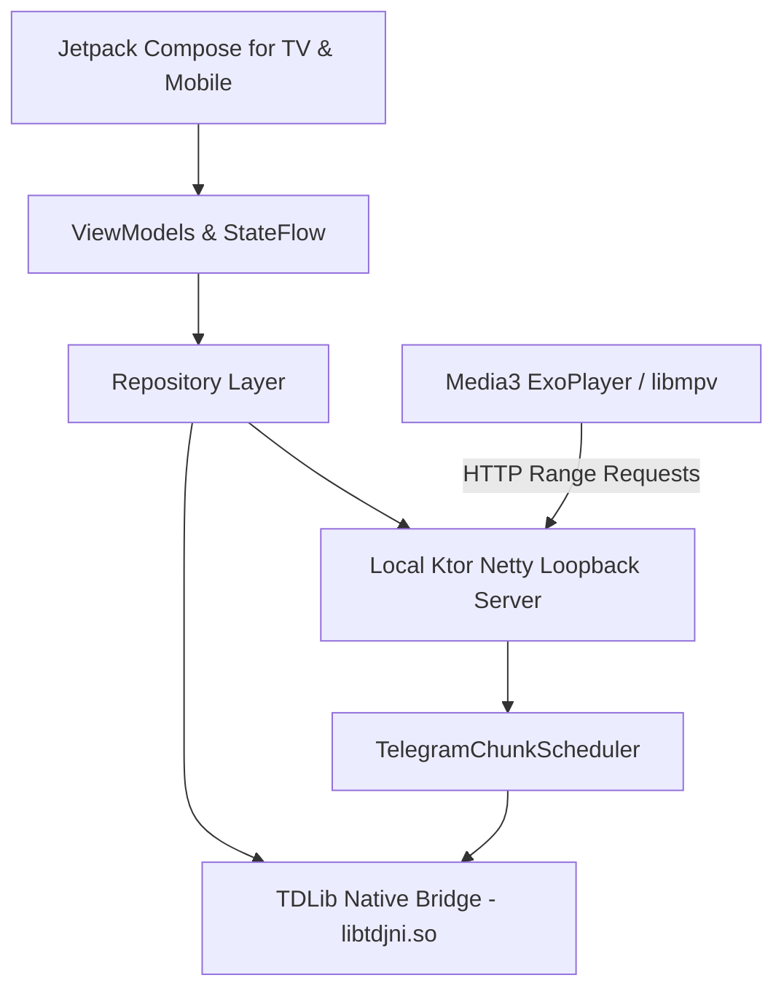

# System Information & Architecture Specification

**Project:** Bousygram (formerly Tele)  
**Package:** `com.vaydelux.bousygram`  
**Version:** 1.0 (versionCode: 10)  
**Last reconciled against source:** October 28, 2026
**Repository base:** commit `b7fce6ba9b0c0f680658622a233360ae88af468e`; working branch `release/enterprise-hardening`
**Evidence boundary:** Gradle checks were run against the modified worktree, which is not yet committed. These results do not attest the base commit or a release commit. See `docs/release/REPOSITORY_AUDIT.md`.

---

## 1. Executive Summary

**Bousygram** is a video-first Android application optimized for **Android TV (Leanback / D-pad)** with adaptive layouts for phones and tablets. It connects to Telegram through the bundled native **TDLib JNI client** to index, stream, and play video content stored in chats, channels, groups, and Saved Messages. The app source uses the JNI `Client.create` path; no TDLib JSON transport is active in this checkout.

Playback uses two on-device loopback HTTP paths backed by the TDLib chunk scheduler: a Ktor/Netty proxy endpoint used by Media3 ExoPlayer and a `ServerSocket` endpoint used by local-file/MPV and selected handoff paths. Both bind to `127.0.0.1`; neither is a separate network service. Bounded range requests do not establish a cumulative disk-cache limit. Private-media Google Cast uses a LAN HTTP endpoint and is disabled in release variants until receiver-trusted TLS is validated.

---

## 2. Host Environment & Toolchain Details

Project toolchain values below come from the Gradle configuration at the audited commit. The hardware and absolute paths recorded in the October 24 snapshot are historical and are not treated as current environment or benchmark evidence.

### 2.1 Operating System & Hardware
| Property | Value |
|---|---|
| **Host OS / CPU / RAM** | Not established by this commit audit; record at benchmark time. |
| **Workspace location** | Host-specific; omit from project architecture documentation. |

### 2.2 Installed Runtimes & SDKs
| Component | Version / Path | Status / Details |
|---|---|---|
| **Java JDK** | Java 21 in repository CI | Local path and patch release are host-specific. |
| **Android SDK** | Compile SDK 37; target SDK 37; min SDK 26 | Configured in `app/build.gradle.kts`; API 37 is Android 17. |
| **Gradle Wrapper** | Gradle `9.4.1` | Configured in `gradle/wrapper/gradle-wrapper.properties`. |
| **Android Gradle Plugin (AGP)** | `9.1.1` | Defined in `gradle/libs.versions.toml`. |
| **Kotlin Compiler** | `2.3.21` (Compose compiler plugin `2.3.21`) | Defined in `gradle/libs.versions.toml`. |
| **Other host tools** | Not project-pinned | Record versions only when a relevant build or benchmark uses them. |

---

## 3. Technology Stack & Key Dependencies



### 3.1 Frameworks & Libraries
- **UI & Layout**: 
  - Jetpack Compose (BOM `2026.05.01`)
  - Jetpack Compose for TV (`androidx.tv:tv-foundation:1.0.0`, `androidx.tv:tv-material:1.1.0`)
  - Material 3 (`androidx.compose.material3`)
  - Coil Compose (`io.coil-kt:coil-compose:2.7.0`)
  - QR Code Generation (`com.google.zxing:core:3.5.3`)
- **Media Playback**:
  - AndroidX Media3 ExoPlayer (`1.10.1`)
  - Media3 HLS module (`media3-exoplayer-hls:1.10.1`)
  - Media3 Session & UI (`media3-session:1.10.1`, `media3-ui:1.10.1`)
  - libmpv Embedded Engine (`dev.jdtech.mpv:libmpv:1.0.0`)
- **Networking & Server**:
  - Ktor Server Netty (`io.ktor:ktor-server-netty:2.3.13`)
  - Kotlinx Coroutines (`1.11.0` Android + Test)
- **Architecture & Lifecycle**:
  - AndroidX Core KTX (`1.18.0`)
  - AndroidX Lifecycle ViewModel & Runtime (`2.10.0`)
  - AndroidX Process Lifecycle (`2.10.0`)

---

## 4. Codebase Architecture & Modular Breakdown

The project follows a modular Clean Architecture under package `com.vaydelux.bousygram`:

### 4.1 `app` (Application & Entry Points)
- `BousygramApp.kt`: Application lifecycle subclass. Initializes native TDLib (`System.loadLibrary("tdjni")`), sets up network connectivity observer, storage garbage collector, log wrapper, and launches `LocalStreamingServer` and `TelegramProxyManager`.
- `MainActivity.kt`: Primary `ComponentActivity`. Hosts Compose navigation and validates external Cast handoff requests. The current Android TV hardening contract forbids PiP support.

### 4.2 `core` (Infrastructure, Native Bridge, & Streaming)
- **`core.media`**:
  - `PlayerEngine.kt` / `PlayerEngineFactory.kt`: Abstraction layer supporting multi-engine playback.
  - `ExoPlayerEngine.kt`: AndroidX Media3 ExoPlayer implementation.
  - `MpvPlayerEngine.kt`: Direct libmpv playback engine for unsupported containers.
  - `PlayerScreen` uses `CapabilityProber` and the selected preference to choose ExoPlayer or MPV; runtime fallback may switch engines after a playback failure. ExoPlayer streams through `TelegramProxyManager`; MPV/local handoff uses `LocalStreamingServer`.
  - `PlaybackSessionController.kt`: Session-aware state controller handling error classification, retry decisions, duration estimation, and active file reference tracking.
  - `VideoFormatSupport.kt`: Progressive container extensions (`.mp4`, `.fmp4`, `.mkv`, `.webm`, `.ts`, `.mov`, `.ogg`, etc.) and MIME mapping.
  - `SeriesMetadataParser.kt` / `MediaDurationResolver.kt`: Series/season grouping and duration resolvers.
- **`core.tdlib`**:
  - `core.tdlib.client.TdLibClient`: Wrapper managing TDLib instance creation, client interaction, and event loops.
  - `core.tdlib.server.LocalStreamingServer` and `TelegramProxyManager`: loopback HTTP endpoints on runtime-selected ports; the former uses `ServerSocket`, the latter Ktor/Netty.
  - `core.tdlib.server.TelegramChunkScheduler`: Coalesces, prioritizes, and streams ordered byte chunks from TDLib without blocking the UI.
  - `core.tdlib.server.StreamAccessRegistry`: Issues random capability tokens scoped per file/resource, with expiry and explicit revocation on playback teardown/track changes. Backgrounding alone is not a general revocation event.
  - `core.tdlib.server.HttpRangeParser`: RFC-compliant byte range parser clamping unbounded ranges and rejecting multi-range/malformed requests.
  - `CacheManager` / `OfflineCacheManager` / `TelegramNativeFileGc` / `TelegramCachePruner`: TDLib-aware tracked-file cleanup. The runtime target is the lesser of 15% of currently available internal app-data storage and a 2 GiB or managed ceiling. It has no minimum floor and is an eviction target, not a hard write cap. The no-managed-override recursion was removed in the current worktree; native TDLib storage can still exceed the target between cleanup passes.
  - `core.tdlib.auth`: `TelegramAuthManager`, `AuthInputPolicy`, and `TdlibDatabaseKeyPolicy`.
- **`core.network`**: `NetworkConnectivityObserver` monitoring WiFi/Ethernet status and signal strength.
- **`core.observability`**: `StructuredPlaybackLogger`, `PlaybackErrorMapper`, and `CrashReporter`.

### 4.3 `data` (Data Management & Security Stores)
- **`data.repository`**:
  - `SavedMessagesRepository.kt` / `SavedMessagesChats.kt`: Telegram chat indexing (main and archived chats), bounded batch fetching, and message paging.
  - `SavedMessagesMediaSearch.kt` / `SavedMessagesGlobalSearch.kt`: Concurrent, progressive search queries across video documents.
  - `ContinueWatchingRepository.kt`: Local resume progress tracker.
- **`data.store`**:
  - `AndroidKeystoreCipher.kt`: AES-GCM encryption using Android Keystore; hardware-backed storage is device-dependent.
  - `ApiCredentialsStore.kt`: Encrypted storage for Telegram `api_id` and `api_hash`.
  - `TdlibDatabaseKeyStore.kt`: Keystore-wrapped 32-byte encryption key for TDLib SQLite databases.
  - `EnterprisePreferences.kt`: User settings (themes, cache size limits, safe/privacy mode, last played position, playback mode).

### 4.4 `presentation` (Compose for TV & Mobile UI)
- **`layout`**: `TvHybridHomeDashboard.kt` — Cinematic Android TV dashboard featuring a top hero banner, horizontal chat source selector, categorized rows, Continue Watching shelf, and Discord/Slack-style Forum Topic channel rail.
- **`media`**: `BrowseScreen.kt`, `PlayerScreen.kt`, `FavoritesScreen.kt`, `VideoPlayerViewModel.kt`. Includes track selection, subtitle picker, playback controls, and sleep timer.
- **`auth`**: `AuthScreen.kt` — Multi-step QR code scanner, phone number input, SMS code verification, and 2FA cloud password authentication.
- **`settings`**: `SettingsScreen.kt` — Diagnostics export, cache cleaner, theme selection, and playback mode toggles.
- **`theme`**: `BousygramTheme.kt` — Four dynamic color presets (`Midnight`, `Aurora`, `Ocean`, `Sunset`) backed by semantic Material 3 color tokens.
- **`components`**: `ChatSourcePicker.kt`, `MediaPosterCard.kt`, `TvGlowMediaCard.kt`, `EnterpriseComponents.kt` (`TvFocusSurface`), `BousygramAdaptiveShell.kt`.

### 4.5 Telegram Forum Topics & Thread Media Isolation Architecture
In forum-enabled Telegram supergroups, media is organized into distinct message threads (forum topics). The application implements an end-to-end multi-layer filtering and isolation pipeline:
1. **Interactive Channel Rail**: Top horizontal rail displaying available forum topics loaded via `TdApi.GetForumTopics` alongside an `# all-channels` aggregate chip with unread badges and topic media counters.
2. **Deterministic UI State Filter (`MediaUiState.filteredAndSortedItems`)**: Guarantees that in-memory collections (`featuredVideos`, `seriesGroups`, category views) immediately re-filter upon topic selection:
   - When `selectedTopicId != null && selectedTopicId != 0`: strictly limits media items to those matching `item.messageThreadId == selectedTopicId`.
   - General Topic (id = 1): accommodates both explicit threadId 1 and legacy messages without thread identifiers (`null` or `0L`).
   - `# all-channels` (`selectedTopicId == null`): resets filtering and displays the entire chat catalog.
3. **Thread-Scoped TDLib Data Fetching (`SavedMessagesMediaSearch.kt`)**:
   - `searchWithFilterInternal`: Dispatches `TdApi.SearchChatMessages` with `topic = TdApi.MessageTopicForum(topicId)` for each media type (`Video`, `Document`, `VideoNote`, `Animation`).
   - `loadMediaFromHistoryInternal`: Bounded fallback automatically invokes `TdApi.GetForumTopicHistory(chatId, topicId, ...)` when `topicId` is selected instead of falling back to global chat history, preventing cross-topic media leakage.
4. **Contextual Thread ID Mapping (`SavedMessagesMediaMapper.kt`)**: Injects `fallbackTopicId` when mapping TDLib message objects, ensuring thread ID preservation even when Telegram servers omit explicit topic identifiers on individual message payloads.
5. **Dynamic Topic Name Resolution**: Resolves human-readable topic names from `availableTopics` into `MediaItem.topicName` and `MediaUiState.topicGroups`, replacing cryptic numeric IDs with clear labels (e.g. "Action Movies", "Anime").

### 4.6 Unified Android TV Design System
The interface enforces a unified design system tailored specifically for 10-foot TV viewing and directional pad (D-pad) navigation:
- **`TvFocusSurface` Foundation**: Standardizes all interactive elements (forum topic chips, category filter tabs, season selector chips, "← All Shows" back button, and chat source cards).
- **Physical D-pad Affordance**: Features a 1.035x spring-animated scale curve (`Spring.StiffnessMediumLow`), dynamic high-contrast glow elevation (`18.dp`), and animated border transitions.
- **Theme Token Architecture**: Fully harmonized with the active `MaterialTheme.colorScheme` preset (`Midnight`, `Aurora`, `Ocean`, `Sunset`). Hardcoded colors (such as raw green `0xFF5EE5BE` and illegible dark-on-dark text `0xFF091418`) are completely replaced by semantic tokens (`primary`, `surfaceVariant`, `onSurface`, `onSurfaceVariant`).

---

## 5. Security & Privacy Controls

1. **Keystore-Backed Credential Security**:
   - Telegram `api_id` and `api_hash` are encrypted using AES-GCM with an Android Keystore key. Hardware-backed storage is device-dependent and is not asserted by this code.
   - Plaintext credentials from legacy versions fail-closed and are purged upon migration.
2. **TDLib Database Encryption**:
   - New database instances are generated with a persistent 256-bit encryption key.
   - Dual-marker validation records mode in both private shared preferences and `noBackupFilesDir`. Mismatched markers fail closed.
3. **Loopback Server Token Scoping**:
   - Local stream URLs (`http://127.0.0.1:<port>/stream?fileId=...&token=...`) require a cryptographically random capability token.
   - Tokens are scoped to a file/resource, expire, and are revoked during playback teardown or track transitions. Backgrounding alone does not always revoke access.
4. **Network Security Configuration**:
   - App cleartext is denied by default; the Network Security Config allows loopback `127.0.0.1` and `localhost`. Native sockets are not governed by the same HTTP client policy.
   - The development Cast endpoint uses HTTP. Private-media Cast is disabled for release and hardened-release until receiver-trusted TLS is validated.
5. **Browsing Privacy Mode**:
   - Optional toggle masking media posters, chat titles, file sizes, duration badges, and recent search history.
6. **Auto-Backup Disabled**:
   - `android:allowBackup="false"` in `AndroidManifest.xml` prevents Telegram auth databases and sessions from being extracted into device cloud backups.

---

## 6. Build Variants & Packaging Gates

Configured in `app/build.gradle.kts`:

| Variant | Minify / Obfuscation | Shrink Resources | Signing Config | Intended Purpose |
|---|---|---|---|---|
| **`debug`** | `false` | `false` | Debug Key | Local development and device testing |
| **`release`** | `true` (R8 / ProGuard)| `true` | Release Keystore required by Gradle gate | Production candidate |
| **`hardenedRelease`** | `true` | `true` | Release Keystore required by Gradle gate | Hardened production candidate |

### Automated Quality & Release Gates:
1. **`verifyTdlibAbiCoverage`**: Checks ELF class/endian/machine, program-header integrity, ABI-specific load alignment, JNI markers, and TDLib commit metadata consistency for `libtdjni.so` in `arm64-v8a` and `armeabi-v7a`. It does not prove source/toolchain provenance or runtime correctness.
2. **Fail-Closed Release Signing Gate**: Release packaging fails closed if `RELEASE_STORE_FILE` and associated signing credentials are not supplied.
3. **Release ABI packaging**: Release APK tasks configure ARM ABI splits and a universal APK; actual output names and contents depend on the invoked task/configuration.

---

## 7. Historical Verification Claims (Not Evidence for the Audited Commit)

The following measurements and pass claims are historical material from an older checkout. They were not rerun in this documentation reconciliation and are not evidence for the audited base commit. The checked-in GitHub Actions workflow defines checks but is not a CI run report; see the commit-specific report at docs/engineering/E0_E1_SOURCE_AUDIT_4190b726.md.

| Stage | Historical command | Historical result (not current-commit evidence) | Historical duration / details |
|---|---|---|---|
| **16 KB Page Alignment** | Native ELF Header Inspection | **PASSED** | All `arm64-v8a` native libraries (`libtdjni.so`, `libmpv.so`, `libavcodec.so`, etc.) verified aligned to `0x4000` (16,384 bytes). |
| **TDLib ABI Coverage** | `.\gradlew.bat :app:verifyTdlibAbiCoverage` | **PASSED** | Verified `arm64-v8a` (21.4 MB) and `armeabi-v7a` (15.7 MB) native libraries. |
| **Kotlin / Compose Compilation** | `.\gradlew.bat :app:compileDebugKotlin` | **PASSED** | 1m 39s. All Jetpack Compose TV screens, ViewModels, and data layers compiled cleanly with 4GB heap. |
| **Android Unit Tests** | `.\gradlew.bat :app:testDebugUnitTest` | **Passed in modified worktree** | JUnit XML reports 262 tests, 0 failures, 0 errors, and 0 skipped; this worktree result is not a commit artifact. |
| **Release Minified APK Assembly** | `.\gradlew.bat assembleRelease` | **PASSED** | 15m 55s. Full R8 code minification, resource shrinking, LintVital verification, ART profile compilation, and split APK packaging completed cleanly. |

### Historical Artifact Claims (Not Verified for This Commit)
- **Directory**: `app/build/outputs/apk/release/`
- **Split APKs**:
  - `Bousygram-v1.0-release-arm64-v8a.apk` (`55,111,094 bytes` ≈ 52.5 MB) — Tailored for modern Android TVs and 64-bit devices with full R8 minification and resource shrinking.
  - `Bousygram-v1.0-release-armeabi-v7a.apk` (`47,053,062 bytes` ≈ 44.8 MB) — Tailored for legacy 32-bit Android TV streaming sticks with full R8 minification and resource shrinking.
  - `Bousygram-v1.0-release-universal.apk` (`93,535,362 bytes` ≈ 89.2 MB) — Complete universal fallback containing all ABIs.
- **APK Package Metadata**: Application ID `com.vaydelux.bousygram`, Version Code `10`, Version Name `1.0`.

---

## 8. Directory Structure Overview

```text
Tele-main--1/
├── app/                                # Android application module
│   ├── build.gradle.kts                # App-level build script (SDK 37, ABI splits, signing gates)
│   ├── proguard-rules.pro              # R8 / ProGuard obfuscation & keep rules
│   └── src/
│       ├── main/
│       │   ├── AndroidManifest.xml     # App permissions, Leanback launcher, NetworkSecurityConfig
│       │   ├── java/com/vaydelux/bousygram/
│       │   │   ├── app/                # Application entry point & MainActivity
│       │   │   ├── core/               # Media engines (ExoPlayer/libmpv), TDLib, Server, Network
│       │   │   │   ├── media/          # TdLibDataSource, UniversalMediaSessionBridge, SeekThumbnails
│       │   │   │   └── tv/             # WatchNextManager (TvContract.WatchNextPrograms)
│       │   │   ├── data/               # Repositories & Keystore encrypted storage
│       │   │   ├── domain/             # Domain entities, ForumTopicChannel, MediaModels
│       │   │   └── presentation/       # Compose for TV dashboards, player HUD, auth, settings
│       │   ├── jniLibs/                # Native libraries (libtdjni.so for arm64-v8a & armeabi-v7a)
│       │   └── res/                    # Drawables, Leanback banners, XML configs, theme values
│       └── test/                       # Unit tests (MediaTopicFiltering, RangeParser, TokenRegistry, Scheduler, Policies)
├── tools/
│   ├── mock-tests/                     # Offline test suites & verification runners
│   └── tdlib/                          # TDLib compilation automation scripts for Android
├── build.gradle.kts                    # Root build script
├── settings.gradle.kts                 # Project repositories & module declarations
├── gradle.properties                   # Accelerated 4GB heap, parallel, and caching settings
├── local.properties                    # Local machine SDK directory & Telegram API keys
└── SYSTEM_INFORMATION.md               # This specification document
```

---

## 9. Developer Quick Reference

### 9.1 Required Environment Variables
For Windows PowerShell sessions, set the JDK path before running Gradle commands:
```powershell
$env:JAVA_HOME = "C:\Users\Jech\AppData\Local\Programs\Eclipse Adoptium\jdk-21.0.12.101-hotspot"
$env:PATH = "$env:JAVA_HOME\bin;$env:PATH"
```

### 9.2 Common Gradle Commands
```powershell
# 1. Verify TDLib native library presence for both 32-bit and 64-bit ABIs
.\gradlew.bat :app:verifyTdlibAbiCoverage

# 2. Execute unit tests; record the commit SHA and actual Gradle result with every run
.\gradlew.bat :app:testDebugUnitTest

# 3. Fast iteration single-split dev build (targeting 32-bit Xiaomi TV A Pro in ~5 minutes)
.\gradlew.bat :app:assembleRelease -PdevAbi=armeabi-v7a

# 4. Assemble full release with all splits (arm64-v8a, armeabi-v7a, universal)
.\gradlew.bat :app:assembleRelease
```

### 9.3 Installing to Android TV Device
Generated release artifacts reside in `app/build/outputs/apk/release/`:
- **32-Bit Android TV (Xiaomi TV A Pro, Mi Box / TV Stick, Fire TV Stick)**:
  `app/build/outputs/apk/release/Bousygram-v1.0-release-universal.apk` (or `armeabi-v7a` split).
- **64-Bit Modern Android TV (Chromecast with Google TV 4K, Nvidia Shield TV)**:
  `arm64-v8a` split or `universal.apk`.

Transfer via USB drive, local network share, or package installer:
```powershell
# Copy to local flash drive or install via local network tool
Copy-Item app/build/outputs/apk/release/*.apk E:\AndroidTV\
```

---

## 10. Local Playback Telemetry Architecture

### 10.1 Telemetry Metrics & Schema
Per-playback telemetry is captured in `PlaybackTelemetryRecorder.kt` and stored in private app preferences. `CrashReporter` uses reflection for Crashlytics, but its `CRASH_REPORTING_ENABLED` build flag is false in debug, release, and hardened-release; external reporting is disabled unless that gate is deliberately changed.

| Metric | Field | Source / Mechanism |
|---|---|---|
| **Time to First Byte** | `timeToFirstByteMs` | Recorded when loopback server / chunk scheduler sends first stream bytes to socket. |
| **Time to First Frame** | `timeToFirstFrameMs` | Recorded when player engine renders initial frame (`EnginePlaybackState.Ready`). |
| **Rebuffer Count** | `rebufferCount` | Incremented every time playback transitions to `Buffering` after first frame. |
| **Total Rebuffer Duration** | `totalRebufferMs` | Cumulative milliseconds spent buffering between first frame and completion/exit. |
| **Engine Used** | `engine` | Engine identifier (`ExoPlayer` or `mpv`). |
| **Video Decoder Name** | `videoDecoderName` | Media3 `AnalyticsListener.onVideoDecoderInitialized` or mpv `video-codec` + `hwdec-current`. |
| **Audio Decoder Name** | `audioDecoderName` | Media3 `AnalyticsListener.onAudioDecoderInitialized` or mpv `audio-codec`. |
| **Container Format** | `container` | Resolved extension/container (`mp4`, `mkv`, `webm`, `ts`, etc.) via `VideoFormatSupport`. |
| **File Size** | `fileSize` | Resolved file size in bytes from TDLib metadata. |
| **Failure Reason** | `failureReason` | `null` on normal completion/exit, or explicit error description on fatal failure. |

### 10.2 Local Storage & Privacy Guard
- **Local telemetry store:** The playback recorder persists its records in private `playback_telemetry` preferences. Diagnostics can be explicitly exported by the user. External crash reporting is build-gated off in all variants.
- **50-Session FIFO Ring Buffer:** Oldest sessions are automatically evicted when total stored sessions exceed 50.
- **Diagnostics Export:** Available in `SettingsScreen.kt` through:
  1. *Copy Diagnostic Report* (human-readable text report)
  2. *Export JSON* (full structured JSON array containing the 50 sessions)
  3. *View Details* (expandable in-app diagnostics accordion)
- **Unit Test Coverage:** `PlaybackTelemetryRecorderTest.kt` contains serializer/storage tests. Its existence does not prove the suite passed at the audited commit.


