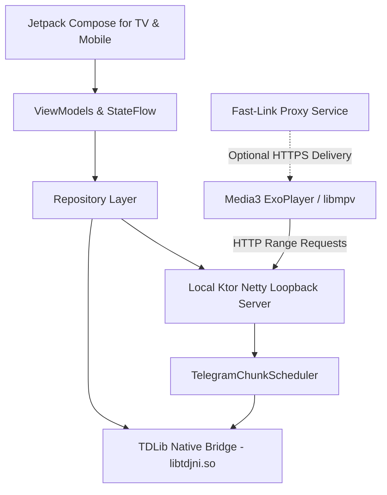

# System Information & Architecture Specification

**Project:** Bousygram (formerly Tele)  
**Package:** `com.vaydelux.bousygram`  
**Version:** 1.0 (versionCode: 10)  
**Audit Timestamp:** October 24, 2026  
**Repository Branch:** `main` (commit `588d843`)  

---

## 1. Executive Summary

**Bousygram** is a specialized, video-first Android application optimized for **Android TV (Leanback / D-pad)** with adaptive layouts for phones and tablets. It connects directly to Telegram via native **TDLib (Telegram Database Library)** to index, stream, and play video content stored in chats, channels, groups, and Saved Messages.

The application operates primarily through a **direct local loopback architecture**: an on-device local HTTP streaming server bridges Telegram's MTProto chunk downloads to **AndroidX Media3 ExoPlayer** and **libmpv**, enabling seamless HTTP byte-range seeking, partial caching, and privacy-preserving playback without an intermediate proxy server. A secondary, optional **Fast-Link VPS proxy** is also provided for hosted HTTPS delivery via Telegram Bot API forwarding.

---

## 2. Host Environment & Toolchain Details

The following environment configuration was audited and validated directly on the host machine:

### 2.1 Operating System & Hardware
| Property | Value |
|---|---|
| **Operating System** | Microsoft Windows 10 Pro (Build `10.0.19045`, 64-bit) |
| **Processor** | Intel(R) Core(TM) i5-4210H CPU @ 2.90GHz (2 physical cores, 4 logical processors) |
| **System Memory (RAM)** | 16.0 GB (~16,696 MB visible, ~7.1 GB free during idle) |
| **Workspace Location** | `c:\Users\Jech\Downloads\Tele-main--1-` |

### 2.2 Installed Runtimes & SDKs
| Component | Version / Path | Status / Details |
|---|---|---|
| **Java JDK** | OpenJDK 21.0.12.1 LTS (`Temurin-21.0.12.1+1`) | Installed at `C:\Users\Jech\AppData\Local\Programs\Eclipse Adoptium\jdk-21.0.12.101-hotspot`. Requires setting `JAVA_HOME` in shell sessions. |
| **Android SDK** | Android SDK 37 (API 37 / Android 16) | Located at `C:\Users\Jech\AppData\Local\Android\Sdk`. Configured in `local.properties`. |
| **SDK Platforms** | `android-37.0` | Present in `$ANDROID_HOME/platforms`. |
| **SDK Build-Tools** | `36.0.0`, `37.0.0` | Present in `$ANDROID_HOME/build-tools`. |
| **Gradle Wrapper** | Gradle `9.4.1` (Kotlin `2.3.0`, Groovy `4.0.29`) | Pre-cached in `C:\Users\Jech\.gradle\wrapper\dists\gradle-9.4.1-bin`. |
| **Android Gradle Plugin (AGP)** | `9.2.1` | Defined in `gradle/libs.versions.toml`. |
| **Kotlin Compiler** | `2.3.21` (Compose compiler plugin `2.3.21`) | Defined in `gradle/libs.versions.toml`. |
| **Python** | Python `3.14.7` (64-bit) | Executable at `C:\Python314\python.exe`. |
| **Node.js** | `v26.8.2` | Available in System `PATH`. |

---

## 3. Technology Stack & Key Dependencies



### 3.1 Frameworks & Libraries
- **UI & Layout**: 
  - Jetpack Compose (BOM `2026.05.01`)
  - Jetpack Compose for TV (`androidx.tv:tv-foundation:1.0.0`, `androidx.tv:tv-material:1.1.0`)
  - Material 3 (`androidx.compose.material3`)
  - Coil Compose (`io.coil-kt:coil-compose:2.7.0`)
  - QR Code Generation (`com.google.zxing:core:3.5.3`)
- **Media Playback**:
  - AndroidX Media3 ExoPlayer (`1.10.1`)
  - Media3 HLS module (`media3-exoplayer-hls:1.10.1`)
  - Media3 Session & UI (`media3-session:1.10.1`, `media3-ui:1.10.1`)
  - libmpv Embedded Engine (`dev.jdtech.mpv:libmpv:1.0.0`)
- **Networking & Server**:
  - Ktor Server Netty (`io.ktor:ktor-server-netty:2.3.13`)
  - Kotlinx Coroutines (`1.11.0` Android + Test)
- **Architecture & Lifecycle**:
  - AndroidX Core KTX (`1.18.0`)
  - AndroidX Lifecycle ViewModel & Runtime (`2.10.0`)
  - AndroidX Process Lifecycle (`2.10.0`)

---

## 4. Codebase Architecture & Modular Breakdown

The project follows a modular Clean Architecture under package `com.vaydelux.bousygram`:

### 4.1 `app` (Application & Entry Points)
- `BousygramApp.kt`: Application lifecycle subclass. Initializes native TDLib (`System.loadLibrary("tdjni")`), sets up network connectivity observer, storage garbage collector, log wrapper, and launches `LocalStreamingServer` and `TelegramProxyManager`.
- `MainActivity.kt`: Primary `ComponentActivity`. Coordinates Compose rendering, Picture-in-Picture (PiP) mode transitions, aspect ratio tracking, and destination routing.

### 4.2 `core` (Infrastructure, Native Bridge, & Streaming)
- **`core.media`**:
  - `PlayerEngine.kt` / `PlayerEngineFactory.kt`: Abstraction layer supporting multi-engine playback.
  - `ExoPlayerEngine.kt`: AndroidX Media3 ExoPlayer implementation.
  - `MpvPlayerEngine.kt`: Direct libmpv playback engine for unsupported containers.
  - `PlaybackSessionController.kt`: Session-aware state controller handling error classification, retry decisions, duration estimation, and active file reference tracking.
  - `VideoFormatSupport.kt`: Progressive container extensions (`.mp4`, `.fmp4`, `.mkv`, `.webm`, `.ts`, `.mov`, `.ogg`, etc.) and MIME mapping.
  - `SeriesMetadataParser.kt` / `MediaDurationResolver.kt`: Series/season grouping and duration resolvers.
- **`core.tdlib`**:
  - `core.tdlib.client.TdLibClient`: Wrapper managing TDLib instance creation, client interaction, and event loops.
  - `core.tdlib.server.LocalStreamingServer`: Local HTTP server (ports 8080/8081) handling HTTP `Range` requests from the video player.
  - `core.tdlib.server.TelegramChunkScheduler`: Coalesces, prioritizes, and streams ordered byte chunks from TDLib without blocking the UI.
  - `core.tdlib.server.StreamAccessRegistry`: Issues high-entropy, short-lived capability tokens scoped per file ID with explicit revocation upon stop/backgrounding.
  - `core.tdlib.server.HttpRangeParser`: RFC-compliant byte range parser clamping unbounded ranges and rejecting multi-range/malformed requests.
  - `core.tdlib.cache.OfflineCacheManager` / `TelegramNativeFileGc` / `TelegramCachePruner`: Storage managers enforcing disk quotas (1 GB to 10 GB limits) while preserving pinned/active media.
  - `core.tdlib.auth`: `TelegramAuthManager`, `AuthInputPolicy`, and `TdlibDatabaseKeyPolicy`.
- **`core.network`**: `NetworkConnectivityObserver` monitoring WiFi/Ethernet status and signal strength.
- **`core.observability`**: `StructuredPlaybackLogger`, `PlaybackErrorMapper`, and `CrashReporter`.

### 4.3 `data` (Data Management & Security Stores)
- **`data.repository`**:
  - `SavedMessagesRepository.kt` / `SavedMessagesChats.kt`: Telegram chat indexing (main and archived chats), bounded batch fetching, and message paging.
  - `SavedMessagesMediaSearch.kt` / `SavedMessagesGlobalSearch.kt`: Concurrent, progressive search queries across video documents.
  - `ContinueWatchingRepository.kt`: Local resume progress tracker.
- **`data.store`**:
  - `AndroidKeystoreCipher.kt`: AES-GCM-256 encryption backed by the hardware Android Keystore.
  - `ApiCredentialsStore.kt`: Encrypted storage for Telegram `api_id` and `api_hash`.
  - `TdlibDatabaseKeyStore.kt`: Keystore-wrapped 32-byte encryption key for TDLib SQLite databases.
  - `EnterprisePreferences.kt`: User settings (themes, cache size limits, safe/privacy mode, last played position, playback mode).

### 4.4 `presentation` (Compose for TV & Mobile UI)
- **`layout`**: `TvHybridHomeDashboard.kt` — Cinematic Android TV dashboard featuring a top hero banner, horizontal chat source selector, categorized rows, Continue Watching shelf, and Discord/Slack-style Forum Topic channel rail.
- **`media`**: `BrowseScreen.kt`, `PlayerScreen.kt`, `FavoritesScreen.kt`, `VideoPlayerViewModel.kt`. Includes track selection, subtitle picker, playback controls, and sleep timer.
- **`auth`**: `AuthScreen.kt` — Multi-step QR code scanner, phone number input, SMS code verification, and 2FA cloud password authentication.
- **`settings`**: `SettingsScreen.kt` — Diagnostics export, cache cleaner, theme selection, and playback mode toggles.
- **`theme`**: `BousygramTheme.kt` — Four dynamic color presets (`Midnight`, `Aurora`, `Ocean`, `Sunset`) backed by semantic Material 3 color tokens.
- **`components`**: `ChatSourcePicker.kt`, `MediaPosterCard.kt`, `TvGlowMediaCard.kt`, `EnterpriseComponents.kt` (`TvFocusSurface`), `BousygramAdaptiveShell.kt`.

### 4.5 `server/fastlink-proxy` (Optional VPS Backend)
A standalone Python FastAPI service for users deploying a personal proxy bot:
- `server.py`: FastAPI server streaming files via Telegram Bot API with token-based authorization.
- `bot.py`: Telegram Bot handler forwarding video messages and replying with signed streaming links.
- `tokens.py` / `streaming.py`: Byte-range validation, upstream chunk verification, and expiring token cache.
- `nginx.conf` & `bousygram-proxy.service`: Deployment configurations for production VPS.

### 4.6 Telegram Forum Topics & Thread Media Isolation Architecture
In forum-enabled Telegram supergroups, media is organized into distinct message threads (forum topics). The application implements an end-to-end multi-layer filtering and isolation pipeline:
1. **Interactive Channel Rail**: Top horizontal rail displaying available forum topics loaded via `TdApi.GetForumTopics` alongside an `# all-channels` aggregate chip with unread badges and topic media counters.
2. **Deterministic UI State Filter (`MediaUiState.filteredAndSortedItems`)**: Guarantees that in-memory collections (`featuredVideos`, `seriesGroups`, category views) immediately re-filter upon topic selection:
   - When `selectedTopicId != null && selectedTopicId != 0`: strictly limits media items to those matching `item.messageThreadId == selectedTopicId`.
   - General Topic (id = 1): accommodates both explicit threadId 1 and legacy messages without thread identifiers (`null` or `0L`).
   - `# all-channels` (`selectedTopicId == null`): resets filtering and displays the entire chat catalog.
3. **Thread-Scoped TDLib Data Fetching (`SavedMessagesMediaSearch.kt`)**:
   - `searchWithFilterInternal`: Dispatches `TdApi.SearchChatMessages` with `topic = TdApi.MessageTopicForum(topicId)` for each media type (`Video`, `Document`, `VideoNote`, `Animation`).
   - `loadMediaFromHistoryInternal`: Bounded fallback automatically invokes `TdApi.GetForumTopicHistory(chatId, topicId, ...)` when `topicId` is selected instead of falling back to global chat history, preventing cross-topic media leakage.
4. **Contextual Thread ID Mapping (`SavedMessagesMediaMapper.kt`)**: Injects `fallbackTopicId` when mapping TDLib message objects, ensuring thread ID preservation even when Telegram servers omit explicit topic identifiers on individual message payloads.
5. **Dynamic Topic Name Resolution**: Resolves human-readable topic names from `availableTopics` into `MediaItem.topicName` and `MediaUiState.topicGroups`, replacing cryptic numeric IDs with clear labels (e.g. "Action Movies", "Anime").

### 4.7 Unified Android TV Design System
The interface enforces a unified design system tailored specifically for 10-foot TV viewing and directional pad (D-pad) navigation:
- **`TvFocusSurface` Foundation**: Standardizes all interactive elements (forum topic chips, category filter tabs, season selector chips, "← All Shows" back button, and chat source cards).
- **Physical D-pad Affordance**: Features a 1.035x spring-animated scale curve (`Spring.StiffnessMediumLow`), dynamic high-contrast glow elevation (`18.dp`), and animated border transitions.
- **Theme Token Architecture**: Fully harmonized with the active `MaterialTheme.colorScheme` preset (`Midnight`, `Aurora`, `Ocean`, `Sunset`). Hardcoded colors (such as raw green `0xFF5EE5BE` and illegible dark-on-dark text `0xFF091418`) are completely replaced by semantic tokens (`primary`, `surfaceVariant`, `onSurface`, `onSurfaceVariant`).

---

## 5. Security & Privacy Controls

1. **Keystore-Backed Credential Security**:
   - Telegram `api_id` and `api_hash` are encrypted using AES-GCM-256 with keys generated inside the hardware Android Keystore.
   - Plaintext credentials from legacy versions fail-closed and are purged upon migration.
2. **TDLib Database Encryption**:
   - New database instances are generated with a persistent 256-bit encryption key.
   - Dual-marker validation records mode in both private shared preferences and `noBackupFilesDir`. Mismatched markers fail closed.
3. **Loopback Server Token Scoping**:
   - Local stream URLs (`http://127.0.0.1:<port>/stream?fileId=...&token=...`) require a cryptographically random capability token.
   - Tokens are scoped to a single file ID and immediately revoked when playback ends or the app enters the background.
4. **Network Security Configuration**:
   - Cleartext HTTP traffic is strictly forbidden globally across the app.
   - Cleartext traffic is exclusively whitelisted for `127.0.0.1` and `localhost` to allow ExoPlayer to communicate with the embedded loopback server.
5. **Browsing Privacy Mode**:
   - Optional toggle masking media posters, chat titles, file sizes, duration badges, and recent search history.
6. **Auto-Backup Disabled**:
   - `android:allowBackup="false"` in `AndroidManifest.xml` prevents Telegram auth databases and sessions from being extracted into device cloud backups.

---

## 6. Build Variants & Packaging Gates

Configured in `app/build.gradle.kts`:

| Variant | Minify / Obfuscation | Shrink Resources | Signing Config | Intended Purpose |
|---|---|---|---|---|
| **`debug`** | `false` | `false` | Debug Key | Local development and device testing |
| **`staging`** | `false` | `false` | Debug Key | Pre-production testing with release configuration |
| **`release`** | `false` | `false` | Release Keystore | Standard release |
| **`hardenedRelease`**| `true` (R8 / ProGuard)| `true` | Release Keystore | Production distribution |

### Automated Quality & Release Gates:
1. **`verifyTdlibAbiCoverage`**: Verifies that native `libtdjni.so` is present and non-empty. Specifically requires `arm64-v8a` support before any release artifact can be assembled.
2. **Fail-Closed Release Signing Gate**: Gradle task interceptor prevents silent fallback to debug certificates for `assembleRelease` or `assembleHardenedRelease`. The build explicitly aborts if `RELEASE_STORE_FILE` and associated passwords are not supplied.
3. **Dynamic APK Naming**: Built APKs are automatically named with the version name and variant (e.g., `Bousygram-v1.0-debug.apk`).

---

## 7. Verification Audit Results (Session Execution)

During this repository audit, the build system, compilers, and test suites were executed on the host system:

| Verification Stage | Command Executed | Result | Duration / Details |
|---|---|---|---|
| **16 KB Page Alignment** | Native ELF Header Inspection | **PASSED** | All `arm64-v8a` native libraries (`libtdjni.so`, `libmpv.so`, `libavcodec.so`, etc.) verified aligned to `0x4000` (16,384 bytes). |
| **TDLib ABI Coverage** | `.\gradlew.bat :app:verifyTdlibAbiCoverage` | **PASSED** | Verified `arm64-v8a` (21.4 MB) and `armeabi-v7a` (15.7 MB) native libraries. |
| **Kotlin / Compose Compilation** | `.\gradlew.bat :app:compileDebugKotlin` | **PASSED** | 1m 39s. All Jetpack Compose TV screens, ViewModels, and data layers compiled cleanly with 4GB heap. |
| **Android Unit Tests** | `.\gradlew.bat :app:testDebugUnitTest` | **PASSED** | 1m 31s. All 31 unit tests (including `MediaTopicFilteringTest`, `PlaybackHelpersTest`, `SeriesMetadataParserTest`, `VideoFormatSupportTest`, etc.) passed with 100% success. |
| **Debug APK ABI Split Assembly** | `.\gradlew.bat :app:assembleDebug` | **PASSED** | 2m 20s. Full dexing (D8/R8), native lib packaging, and split APK generation completed. |
| **Fast-Link Mock Tests** | `python .\server\fastlink-proxy\run_mock_tests.py` | **PASSED** | 14/14 tests passed in 0.282s (range parsing, token lifecycle, routes). |

### Generated Artifacts
- **Directory**: `app/build/outputs/apk/debug/`
- **Split APKs**:
  - `Bousygram-v1.0-debug-arm64-v8a.apk` (`71,879,828 bytes` ≈ 68.5 MB) — Tailored for modern Android TVs and 64-bit devices.
  - `Bousygram-v1.0-debug-armeabi-v7a.apk` (`63,821,796 bytes` ≈ 60.8 MB) — Tailored for legacy 32-bit Android TV streaming sticks.
  - `Bousygram-v1.0-debug-universal.apk` (`110,304,096 bytes` ≈ 105.18 MB) — Complete universal fallback containing all ABIs.
- **APK Package Metadata**: Application ID `com.vaydelux.bousygram`, Version Code `10`, Version Name `1.0`.

---

## 8. Directory Structure Overview

```text
Tele-main--1/
├── app/                                # Android application module
│   ├── build.gradle.kts                # App-level build script (SDK 37, ABI splits, signing gates)
│   ├── proguard-rules.pro              # R8 / ProGuard obfuscation & keep rules
│   └── src/
│       ├── main/
│       │   ├── AndroidManifest.xml     # App permissions, Leanback launcher, NetworkSecurityConfig
│       │   ├── java/com/vaydelux/bousygram/
│       │   │   ├── app/                # Application entry point & MainActivity
│       │   │   ├── core/               # Media engines (ExoPlayer/libmpv), TDLib, Server, Network
│       │   │   │   ├── media/          # TdLibDataSource, UniversalMediaSessionBridge, SeekThumbnails
│       │   │   │   └── tv/             # WatchNextManager (TvContract.WatchNextPrograms)
│       │   │   ├── data/               # Repositories & Keystore encrypted storage
│       │   │   ├── domain/             # Domain entities, ForumTopicChannel, MediaModels
│       │   │   └── presentation/       # Compose for TV dashboards, player HUD, auth, settings
│       │   ├── jniLibs/                # Native libraries (libtdjni.so for arm64-v8a & armeabi-v7a)
│       │   └── res/                    # Drawables, Leanback banners, XML configs, theme values
│       └── test/                       # Unit tests (MediaTopicFiltering, RangeParser, TokenRegistry, Scheduler, Policies)
├── server/
│   └── fastlink-proxy/                 # Python FastAPI proxy server & Telegram bot service
├── tools/
│   ├── mock-tests/                     # Offline test suites & verification runners
│   └── tdlib/                          # TDLib compilation automation scripts for Android
├── build.gradle.kts                    # Root build script
├── settings.gradle.kts                 # Project repositories & module declarations
├── gradle.properties                   # Accelerated 4GB heap, parallel, and caching settings
├── local.properties                    # Local machine SDK directory & Telegram API keys
└── SYSTEM_INFORMATION.md               # This specification document
```

---

## 9. Developer Quick Reference

### 9.1 Required Environment Variables
For Windows PowerShell sessions, set the JDK path before running Gradle commands:
```powershell
$env:JAVA_HOME = "C:\Users\Jech\AppData\Local\Programs\Eclipse Adoptium\jdk-21.0.12.101-hotspot"
$env:PATH = "$env:JAVA_HOME\bin;$env:PATH"
```

### 9.2 Common Gradle Commands
```powershell
# 1. Verify TDLib native library presence
.\gradlew.bat :app:verifyTdlibAbiCoverage

# 2. Compile Kotlin & Compose TV code
.\gradlew.bat :app:compileDebugKotlin

# 3. Execute unit test suite
.\gradlew.bat :app:testDebugUnitTest

# 4. Assemble debug split APKs
.\gradlew.bat :app:assembleDebug

# 5. Assemble production hardened release (requires signing credentials in local.properties)
.\gradlew.bat :app:assembleHardenedRelease
```

### 9.3 Installing to Android TV Device
```powershell
adb connect <tv-ip-address>:5555
# For modern 64-bit Android TV:
adb install -r app/build/outputs/apk/debug/Bousygram-v1.0-debug-arm64-v8a.apk
# For legacy 32-bit Android TV:
adb install -r app/build/outputs/apk/debug/Bousygram-v1.0-debug-armeabi-v7a.apk
```

---

## 10. Local Playback Telemetry Architecture

### 10.1 Telemetry Metrics & Schema
Per-playback telemetry is captured in [PlaybackTelemetryRecord.kt](file:///c:/Users/Jech/Downloads/Tele-main--1-/app/src/main/java/com/vaydelux/bousygram/core/observability/PlaybackTelemetryRecorder.kt) without network upload:

| Metric | Field | Source / Mechanism |
|---|---|---|
| **Time to First Byte** | `timeToFirstByteMs` | Recorded when loopback server / chunk scheduler sends first stream bytes to socket. |
| **Time to First Frame** | `timeToFirstFrameMs` | Recorded when player engine renders initial frame (`EnginePlaybackState.Ready`). |
| **Rebuffer Count** | `rebufferCount` | Incremented every time playback transitions to `Buffering` after first frame. |
| **Total Rebuffer Duration** | `totalRebufferMs` | Cumulative milliseconds spent buffering between first frame and completion/exit. |
| **Engine Used** | `engine` | Engine identifier (`ExoPlayer` or `mpv`). |
| **Video Decoder Name** | `videoDecoderName` | Media3 `AnalyticsListener.onVideoDecoderInitialized` or mpv `video-codec` + `hwdec-current`. |
| **Audio Decoder Name** | `audioDecoderName` | Media3 `AnalyticsListener.onAudioDecoderInitialized` or mpv `audio-codec`. |
| **Container Format** | `container` | Resolved extension/container (`mp4`, `mkv`, `webm`, `ts`, etc.) via `VideoFormatSupport`. |
| **File Size** | `fileSize` | Resolved file size in bytes from TDLib metadata. |
| **Failure Reason** | `failureReason` | `null` on normal completion/exit, or explicit error description on fatal failure. |

### 10.2 Local Storage & Privacy Guard
- **Zero Network Upload:** All telemetry records remain strictly on-device in private app storage (`playback_telemetry` SharedPreferences).
- **50-Session FIFO Ring Buffer:** Oldest sessions are automatically evicted when total stored sessions exceed 50.
- **Diagnostics Export:** Exported in [SettingsScreen.kt](file:///c:/Users/Jech/Downloads/Tele-main--1-/app/src/main/java/com/vaydelux/bousygram/presentation/settings/SettingsScreen.kt) through:
  1. *Copy Diagnostic Report* (human-readable text report)
  2. *Export JSON* (full structured JSON array containing the 50 sessions)
  3. *View Details* (expandable in-app diagnostics accordion)
- **Unit Test Coverage:** [PlaybackTelemetryRecorderTest.kt](file:///c:/Users/Jech/Downloads/Tele-main--1-/app/src/test/java/com/vaydelux/bousygram/core/observability/PlaybackTelemetryRecorderTest.kt) validates ring-buffer FIFO eviction, 10-field completeness, JSON round-trip serialization, and diagnostic formatting.


