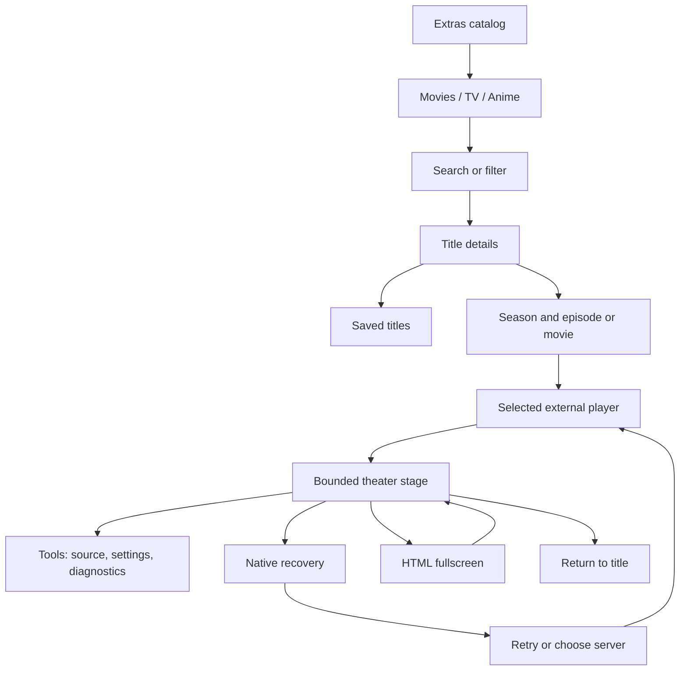

# Extras theater and discovery redesign — first implementation
Reference revisions: Zoku TV ebc6c26, Bousygram 74734c5 (last qualified debug).
Preserve Telegram Media unchanged. Use the shared native theme system, never copy web CSS or browser sandbox assumptions verbatim.

## Workflow

## Design
- Discovery: Telegram-style compact header, segmented catalog navigation, unified search/filter row on wide displays, stable poster grid and glass-styled saved/recent navigation. Existing per-tab search, paging window and focus restoration remain.
- Detail: glass profile surface, retain responsive artwork, synopsis, season/episode list, trailers, cast and metadata. Play and save stay explicit. No implied playback progress from metadata or iframe loads.
- Theater: video occupies remaining height, title and server controls in compact chrome, episode navigation below. Tools dialog contains diagnostics, explicit compatibility consent, reload and existing native-source controls; the WebView is not remounted merely by opening Tools.
- Security: reject child windows and JS dialogs. Small known tracker-domain list with exact DNS boundaries, never block the selected main document by that privacy rule. Do not promise removal of provider-controlled in-page overlays, DRM, or third-party playback availability. Preserve HTTPS, title identity, cookie opt-in, TLS rejection, no local access, and recovery.
- Devices: 320–430dp phones, landscape, TV 960×540dp, larger TVs/tablets, 1.0–2.0 font scale; 48dp minimum touch targets, 56dp TV controls where already applicable. Preserve low-memory bounded caches and no background scrape.

## Qualification and remaining work
Run offline request-policy and UI tests, emulator real-launch and D-pad smoke, test all 16 themes/Reduce Transparency, then test user-authorized real sources and physical ARM32 TV. Inspect actual screenshots; this document is a design contract, not proof of rendered pixels.
Next design work: richer scrollable discovery rails using actual catalog data, consolidated title-detail information hierarchy and saved/recent cards; do not fabricate provider availability or watch progress. Consider GeckoView only after measuring WebView version/codec limitations, APK and memory impact. Do not add a new playback engine merely to work around providers' page behavior.

## Phase 2–3 implementation
The featured block and bounded lazy rails now occupy full-span items within the existing grid; poster restoration includes the exact prefix count. Saved/recent rails use only local metadata for the active category; highly rated uses existing results with numeric scores ≥8. No extra API traffic or fake watch history. Narrow/short windows and filtered searches remain grid-only. Episode artwork has bounded decoding and fallback visuals; primary actions use concise labels. Qualification still required.
