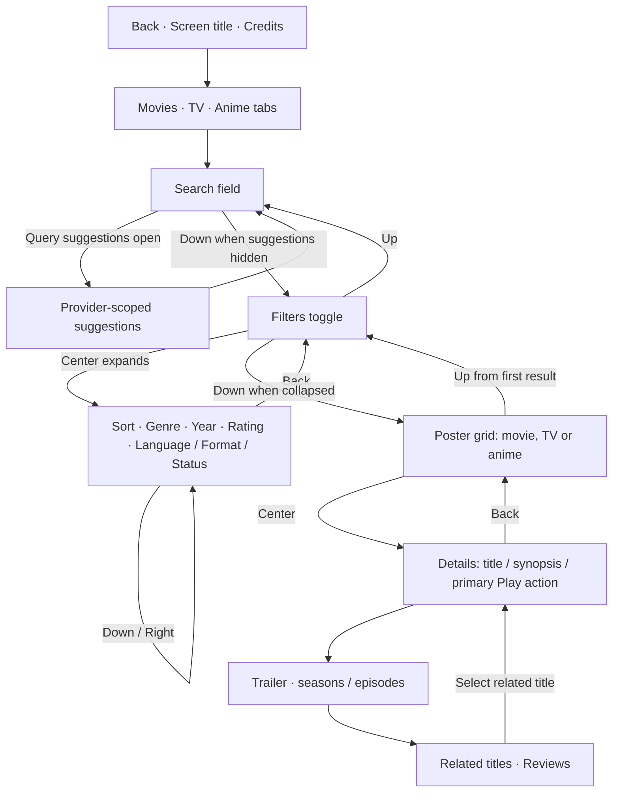

# Extras — Android focus and viewport contract

Android-only UI reference. This replaces the abandoned GitHub Pages/Wasm
preview direction. The app stays in **Jetpack Compose for Android**, with
Media3, LibVLC, TDLib and Android TV controls unchanged.

## Focus map (TV / remote)



### Implementation behavior

- First TV entry requests focus on the selected Extras category tab.
- Category tabs and filter chips form individual focus groups.
- Search Down targets Filters when autocomplete is closed. With suggestions
  open, suggestions remain in keyboard focus order instead of being bypassed.
- Filters Up returns to Search. When collapsed, Filters Down targets the first
  poster, if available. When expanded, Down follows the visible filter buttons.
- The results grid uses stable `type:id` keys; after a detail Back action,
  its previous index and selected poster focus are restored.
- Dropdowns have a bounded 320dp menu height for short TV viewports; menu items
  retain 48dp minimum control height and keyboard focus.
- Season and related-title carousels form focus groups for horizontal traversal.
  Cast credits are informational and do not trap D-pad focus. Search clear,
  retry, filter reset, paging, episode play and review expansion remain reachable.
- Back collapses active search suggestions and expanded filters before exiting
  Extras. Normal Android Back handling remains in place.

## Viewport matrix

| Screen | Typical bounds | Toolbar / filter | Poster layout | Focus |
| --- | --- | --- | --- | --- |
| Compact phone | 320–359dp portrait | 12dp gutter, 16dp gap | two 128dp minimum cards at 320dp | touch / keyboard |
| Standard phone | 360–599dp portrait | 16dp gutter, 16dp gap | adaptive 144dp cards | touch / keyboard |
| Phone landscape | 560–915dp × 320–500dp | compact header, 12dp search/filter gap | responsive 160dp cards; preserve results viewport | touch / D-pad |
| Tablet | 600–899dp | 24dp gutter, 16dp gap | 160dp cards | keyboard / touch |
| Small TV | 960 × 540dp | 32dp gutter, 16dp gap, 56dp controls | 176dp cards | D-pad |
| Full HD / large TV | 1280–1920dp logical | 32dp gutter and 56dp controls | adaptive 176dp cards | D-pad |

Screen sizes are **layout dp**, not physical pixels. A 4K TV is not necessarily
a 3840dp Compose canvas. The Extras policy also respects larger phone font
scale by allocating fewer, wider cards instead of truncating labels.

## Visual spacing guide

```text
┌───────────────────────────────────────────────────┐
│ Back     Explore Extras                    Credits │
│ [ Movies ]  [ TV Shows ]  [ Anime ]                │
├───────────────────────────────────────────────────┤
│  Search movies                                      │
│  ┌───────────────────────────────────────────────┐ │
│  │ 🔎 Title or keyword                           │ │
│  └───────────────────────────────────────────────┘ │
│                 12–16dp                             │
│  [ ⚙ Filters ]      Sort, genre, year and more      │
│                 12–18dp                             │
│  ┌──────────────┐ ┌──────────────┐ ┌──────────────┐ │
│  │    poster    │ │    poster    │ │    poster    │ │
│  │    title     │ │    title     │ │    title     │ │
│  └──────────────┘ └──────────────┘ └──────────────┘ │
└───────────────────────────────────────────────────┘
```

### Verification

`ExtrasLayoutPolicyTest` asserts gutter, control height, grid density and
section gaps across 320–1920dp logical viewports and font scales. The Android
instrumentation suite adds measured search/filter bounds, filter D-pad Center
activation and dark/light screenshot evidence of the control stack.

**Physical QA still required:** 32-bit/64-bit Google TV D-pad focus speed,
fast key-repeat behavior, remote Back during IME entry, native WebView player
virtual cursor, and long-session poster paging. Passing emulators does not
prove those conditions on every vendor firmware.
